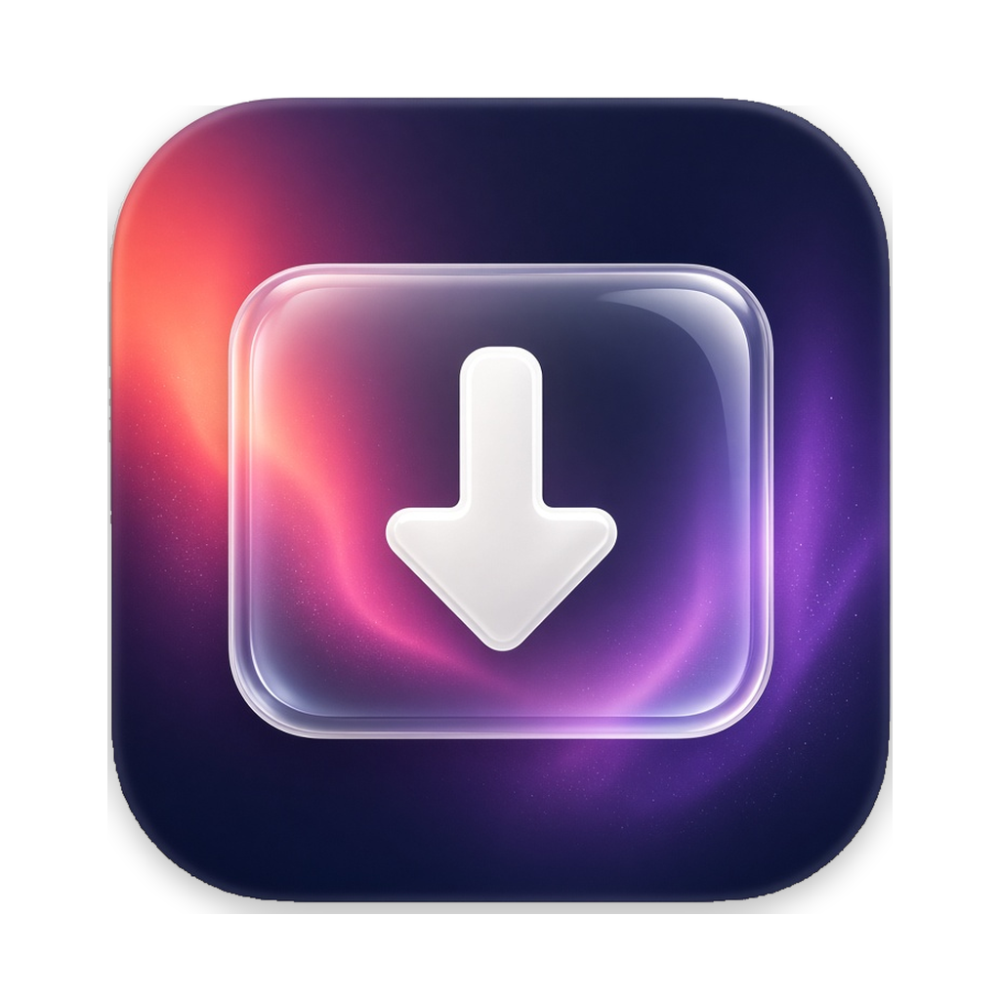
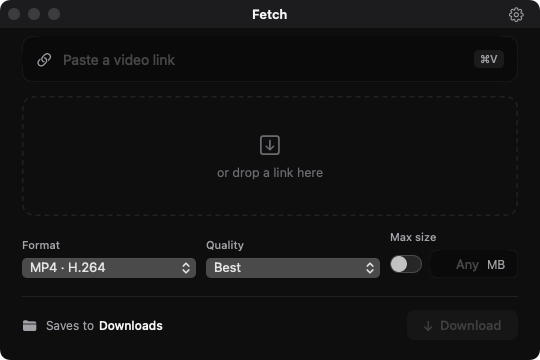
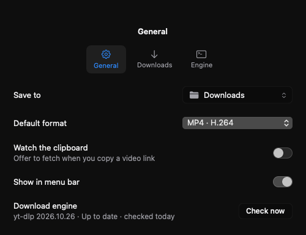

<p align="center">
  
</p>

<h1 align="center">Fetch</h1>

<p align="center">Save a video from a link.</p>

Fetch is a native macOS app. Paste or drop a public video URL, check the preview, and download the file to a folder you choose. It is built with SwiftUI and keeps the download engine on your Mac.

## Screenshots

The main window and Settings, in dark mode. These are renders of the app, not mockups.

<p align="center">
  
  
</p>

## Features

- One window for the link, the preview, the format, the quality, and the download.
- Formats: MP4 (H.264 or HEVC), MOV, WebM, MKV, M4A, and MP3.
- Video quality offers only the resolutions the source actually has. Audio quality is Best or a bitrate (320, 256, 192, or 128 kbps).
- An optional size cap. When the best file is larger than the cap, Fetch picks a smaller format that fits, or re-encodes with the Apple hardware encoder and checks the result.
- A preview with the title, the site, the duration, the size, and the codecs. A TikTok **No watermark** badge appears only when the chosen stream is the clean Direct copy.
- Clipboard watching, off until you turn it on. It offers known video hosts and does not start a download until you accept.
- A menu-bar extra.
- Cancel stops the download, including ffmpeg.
- yt-dlp, ffmpeg, ffprobe, and Deno are copied into Application Support, checked against a signed SHA-256, and can update from the published checksums.

## Requirements

- macOS 14 or later
- An Apple Silicon Mac. The bundled engines are arm64.

You do not install yt-dlp or ffmpeg yourself. The first launch copies them out of the app and checks the checksum recorded at build time. Later launches reuse that copy. A newer yt-dlp is kept only when it matches the published SHA-256. An unchanged version counts as up to date only when the updater exits 0.

## Install

The build is ad-hoc signed and not notarized. Gatekeeper will block the first open. On macOS 15 and later, right-click **Open** does not bypass that.

1. Download **Fetch-macOS** from the latest [GitHub Actions](https://github.com/jx-zheng/fetch-mac/actions) run, or from [Releases](https://github.com/jx-zheng/fetch-mac/releases) when a release is published. The Actions artifact is a zip named `Fetch-macOS.zip`. Inside it are `Fetch.zip` and `Fetch.dmg`. Unzip `Fetch.zip` to get `Fetch.app`. Actions artifacts expire after 90 days.
2. Move `Fetch.app` to `/Applications`.
3. Open it once so Gatekeeper records the refusal. Then either:
   - **System Settings → Privacy & Security → Open Anyway**, or
   - clear the quarantine flag:

```bash
xattr -dr com.apple.quarantine /Applications/Fetch.app
```

## Usage

Paste a video link into the field, or drop one on the window. Fetch shows a preview when it can read the page. **Download** stays off until that preview is ready. Changing the link clears the previous preview immediately, including while a new link is still being resolved.

The title and the settings button sit in the window’s title bar, on the same row as the traffic lights. Drag empty space in that bar to move the window. Double-click follows the system setting for the title bar (zoom, minimize, or nothing). The settings button does not drag the window.

- **Format** chooses the container and whether the file is video or audio.
- **Quality** follows the format. Video lists Best and the resolutions the source reaches. Audio lists Best and bitrates. The menu always shows a selection.
- **Max size** is off until you turn it on. With it off, the field reads **Any MB**. With it on, type a size in megabytes. Audio formats ignore the cap.
- **Saves to** is your Downloads folder until you pick another one. The gear opens Settings.

A sign-in error can offer your Safari cookies for that one link. Reading those cookies needs Full Disk Access (**System Settings → Privacy & Security → Full Disk Access**). The error card opens that pane. The choice covers the info fetch and the download of that link, then it turns off.

## Settings

Settings has three tabs: General, Downloads, and Engine. The whole tab tile is clickable, including the padding around the icon and the title.

**General**

- **Save to** picks the folder.
- **Default format** is the format used for a new link.
- **Watch the clipboard** offers a link you copy from YouTube, TikTok, Instagram, X, Reddit, or Vimeo. It does not download until you accept.
- **Show in menu bar** keeps Fetch in the menu bar.
- **Check now** looks for an engine update.

**Downloads**

- **Video quality** is the saved default for video formats (Best, 2160p, 1080p, 720p, or 480p). A new link starts from this and snaps down when the source is shorter. That snap does not overwrite the default.
- **Audio quality** is a separate default (Best or a bitrate).
- **Max size** is the default cap. Files are named from the video title. Characters that do not belong in a file name are removed, and Fetch does not write outside the folder you pick.

**Engine**

yt-dlp, ffmpeg, and Deno live in Application Support so the engine can update itself. **Update stable** is the normal channel. **Update nightly** is for a site that changed before the stable engine can read it. Fetch checks the published SHA-256 before it runs a new build.

## Build from source

The app is a Swift package. You need macOS 14 or later, Xcode, and Python 3.

```bash
python3 Scripts/fetch_engines.py
bash Scripts/build-app.sh
```

`Scripts/fetch_engines.py` downloads the arm64 engines and checks their published checksums. `Scripts/build-app.sh` builds `Fetch.app`, ad-hoc signs it, and writes `artifacts/Fetch.zip` and `artifacts/Fetch.dmg`.

Screenshots and the end-to-end checks:

```bash
artifacts/Fetch.app/Contents/MacOS/Fetch --screenshots artifacts/screenshots
bash Scripts/e2e.sh
```

The same binary can drive the engine without the window:

```bash
Fetch --cli version
Fetch --cli metadata <url>
Fetch --cli update stable
Fetch --cli download <url> --output <directory> [--max-mb N] [--limit-rate 80K]
```

## Project structure

| Path | What it is |
| --- | --- |
| `Sources/FetchCore` | URLs, file names, formats, quality, size math, progress parsing, and errors. Builds on Linux. |
| `Sources/Fetch` | The SwiftUI app, the download engine, and the window. macOS 14 and later. |
| `Tests/FetchCoreTests` | Unit tests for FetchCore. |
| `Scripts` | Engine download, app build, and the end-to-end script. |
| `Fetch` | The app icon set. |
| `design/icon-approved.png` | The approved icon artwork. |
| `.github/workflows/macos.yml` | CI. |

## Testing and CI

Pull requests run two jobs. **FetchCore** runs the unit tests on Linux with Swift 6.2. **macOS** runs only after that job passes. It builds the app on `macos-15`, downloads the engines, takes screenshots, and runs `Scripts/e2e.sh`.

That script checks the engine update, a 30 second cold launch and a 30 second warm launch (mean CPU from 10s to 30s at or below 2%, and a flat memory footprint), the title bar (opaque, draggable, title and settings on the traffic-light row), Settings tab hit targets, a real download, a re-encode under a size cap, and cancel while ffmpeg is running.

```bash
swift test --filter FetchCoreTests
```

## Limits

- One video at a time. Playlists are ignored.
- A burned-in watermark cannot be removed.
- Some private posts need a browser sign-in. Safari cookies on recent macOS need Full Disk Access.
- WebM uses a software VP9 encoder. H.264 and HEVC use VideoToolbox, and fall back to a software encoder if VideoToolbox refuses the file.
- YouTube sometimes asks a datacenter address to sign in. A home connection usually does not. There is no telemetry. Fetch does not phone home except for the download itself, thumbnail images, and the engine update check.

## License

Fetch is released under the [MIT License](LICENSE).
